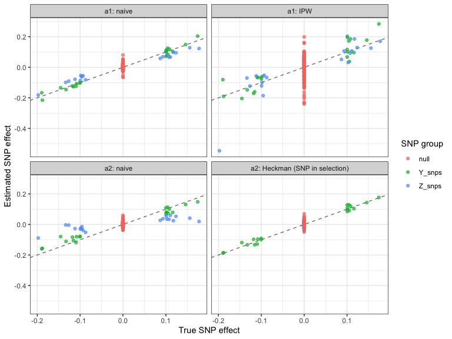

Module (a): Non-representative participation
================

- [Scenario](#scenario)
- [1. The problem: naive GWAS among
  participants](#1-the-problem-naive-gwas-among-participants)
- [2. Diagnostics](#2-diagnostics)
  - [Participation GWAS](#participation-gwas)
  - [Negative control outcome](#negative-control-outcome)
- [3. Corrections](#3-corrections)
  - [Inverse probability weighting](#inverse-probability-weighting)
  - [Heckman correction](#heckman-correction)
- [4. Summary](#4-summary)

``` r
library(ggplot2)
source("1_functions/gwas_helpers.R")
source("3_diagnostics/participation_gwas.R")
source("3_diagnostics/negative_controls.R")
source("4_correction-individual-level/ipw.R")
source("4_correction-individual-level/heckman.R")

cols <- c("analysis", "snp_group", "rel_bias_causal", "coverage", "power",
          "type1_error")
```

## Scenario

Figure 2(a). Genotype G affects the outcome Y directly and through a
measured, heritable predictor Z (e.g. education). An unmeasured factor U
also affects Y. Participation S depends on:

- **a1:** Z and E (E predicts participation but not Y), i.e. selection
  on measured factors;
- **a2:** Z, E and Y itself, i.e. selection on the outcome.

N is a negative control outcome: it has no genetic effects but shares
non-genetic causes with Z and Y. SNPs are grouped by what they affect: Y
directly (`Y_snps`), Z (`Z_snps`), or nothing (`null`).

``` r
if (!file.exists("data/module_a.rds")) source("2_simulations/a_participation.R")
d <- readRDS("data/module_a.rds")
p <- d$pheno

knitr::kable(data.frame(parameter = names(d$params),
                        value = unlist(d$params)), row.names = FALSE)
```

| parameter  | value |
|:-----------|------:|
| n          | 5e+04 |
| m          | 2e+02 |
| n_causal_y | 2e+01 |
| n_causal_z | 2e+01 |
| h2_y       | 1e-01 |
| h2_z       | 3e-01 |
| b_zy       | 5e-01 |
| b_uy       | 5e-01 |
| g_z        | 8e-01 |
| g_e        | 6e-01 |
| g_y        | 6e-01 |
| rate       | 3e-01 |

## 1. The problem: naive GWAS among participants

``` r
full <- run_gwas(p$Y, d$G)
a1   <- run_gwas(p$Y[p$S_a1 == 1], d$G[p$S_a1 == 1, ])
a2   <- run_gwas(p$Y[p$S_a2 == 1], d$G[p$S_a2 == 1, ])

knitr::kable(rbind(
  compare_by_group(full, d$truth, d$groups, "full cohort"),
  compare_by_group(a1,   d$truth, d$groups, "a1 naive"),
  compare_by_group(a2,   d$truth, d$groups, "a2 naive")
)[, cols], digits = 3, row.names = FALSE)
```

| analysis    | snp_group | rel_bias_causal | coverage | power | type1_error |
|:------------|:----------|----------------:|---------:|------:|------------:|
| full cohort | Y_snps    |          -0.013 |    0.900 |  1.00 |         NaN |
| full cohort | Z_snps    |          -0.030 |    0.950 |  1.00 |         NaN |
| full cohort | null      |             NaN |    0.944 |   NaN |       0.056 |
| a1 naive    | Y_snps    |           0.016 |    0.950 |  1.00 |         NaN |
| a1 naive    | Z_snps    |          -0.253 |    0.600 |  1.00 |         NaN |
| a1 naive    | null      |             NaN |    0.944 |   NaN |       0.056 |
| a2 naive    | Y_snps    |          -0.173 |    0.700 |  1.00 |         NaN |
| a2 naive    | Z_snps    |          -0.689 |    0.000 |  0.65 |         NaN |
| a2 naive    | null      |             NaN |    0.919 |   NaN |       0.081 |

Selection on Z biases the SNPs that act through Z (a1). Selection on the
outcome also biases the SNPs acting directly on Y (a2). Null SNPs are
barely affected, so a genome-wide summary such as λ hides the problem.

## 2. Diagnostics

### Participation GWAS

``` r
for (sc in c("S_a1", "S_a2")) {
  pg <- participation_gwas(p[[sc]], d$G)
  s  <- summarise_participation(pg)
  cat(sprintf("\n%s: lambda = %.2f\n", sc, attr(s, "lambda")))
  print(s, row.names = FALSE)
  cat("Proportion of SNPs with p < 0.05, by group:\n")
  print(round(sapply(d$groups, function(i) mean(pg$p[i] < 0.05)), 2))
}
```

    ## 
    ## S_a1: lambda = 1.07
    ##  threshold observed expected   ratio
    ##      5e-02       23    1e+01 2.3e+00
    ##      1e-03       20    2e-01 1.0e+02
    ##      5e-08       20    1e-05 2.0e+06
    ## Proportion of SNPs with p < 0.05, by group:
    ## Y_snps Z_snps   null 
    ##   0.00   1.00   0.02 
    ## 
    ## S_a2: lambda = 2.43
    ##  threshold observed expected    ratio
    ##      5e-02       51    1e+01 5.10e+00
    ##      1e-03       35    2e-01 1.75e+02
    ##      5e-08       21    1e-05 2.10e+06
    ## Proportion of SNPs with p < 0.05, by group:
    ## Y_snps Z_snps   null 
    ##   1.00   1.00   0.07

Without a participation indicator, compare allele frequencies with a
population reference. Here the participants are part of the reference,
so `nested = TRUE`.

``` r
af <- allele_freq_test(d$G[p$S_a2 == 1, ], d$G, nested = TRUE)
summarise_participation(af)
```

    ##   threshold observed expected    ratio
    ## 1     5e-02       51    1e+01 5.10e+00
    ## 2     1e-03       35    2e-01 1.75e+02
    ## 3     5e-08       21    1e-05 2.10e+06

### Negative control outcome

``` r
for (sc in c("S_a1", "S_a2")) {
  nc <- negative_control_outcome(p$N, d$G, selected = p[[sc]] == 1,
                                 reference = rep(TRUE, nrow(p)))
  cat("\n", sc, "\n")
  print(rbind(
    cbind(snp_group = "all (participants)", summarise_negative_control(nc$sample)),
    cbind(snp_group = "all (reference)",    summarise_negative_control(nc$reference)),
    do.call(rbind, lapply(names(d$groups), function(g)
      cbind(snp_group = g, summarise_negative_control(nc$sample, d$groups[[g]]))))
  ), row.names = FALSE)
}
```

    ## 
    ##  S_a1 
    ##           snp_group n_snps   lambda prop_p_lt_alpha n_gw_sig
    ##  all (participants)    200 1.263681         0.05500        0
    ##     all (reference)    200 1.050463         0.04000        0
    ##              Y_snps     20 1.055519         0.05000        0
    ##              Z_snps     20 5.988952         0.35000        0
    ##                null    160 1.088675         0.01875        0
    ## 
    ##  S_a2 
    ##           snp_group n_snps     lambda prop_p_lt_alpha n_gw_sig
    ##  all (participants)    200  1.3057315         0.08500        0
    ##     all (reference)    200  1.0504629         0.04000        0
    ##              Y_snps     20  1.9805555         0.05000        0
    ##              Z_snps     20 19.0140826         0.65000        0
    ##                null    160  0.8876392         0.01875        0

Inflation is concentrated in the SNPs linked to selection and diluted in
the genome-wide λ.

## 3. Corrections

### Inverse probability weighting

``` r
ipw_res <- list()
for (sc in c("S_a1", "S_a2")) {
  sel <- p[[sc]] == 1
  w   <- ipw_weights(p[[sc]], covar = p[, c("Z", "E")])
  cat(sprintf("%s: %d participants, effective sample size %.0f\n",
              sc, sum(sel), attr(w, "ess")))
  ipw_res[[sc]] <- ipw_gwas(p$Y[sel], d$G[sel, ], w)
}
```

    ## S_a1: 14970 participants, effective sample size 2452
    ## S_a2: 15090 participants, effective sample size 819

``` r
knitr::kable(rbind(
  compare_by_group(ipw_res$S_a1, d$truth, d$groups, "a1 IPW"),
  compare_by_group(ipw_res$S_a2, d$truth, d$groups, "a2 IPW")
)[, cols], digits = 3, row.names = FALSE)
```

| analysis | snp_group | rel_bias_causal | coverage | power | type1_error |
|:---------|:----------|----------------:|---------:|------:|------------:|
| a1 IPW   | Y_snps    |           0.083 |    0.950 |  0.70 |         NaN |
| a1 IPW   | Z_snps    |           0.052 |    1.000 |  0.60 |         NaN |
| a1 IPW   | null      |             NaN |    0.963 |   NaN |       0.038 |
| a2 IPW   | Y_snps    |          -0.287 |    0.900 |  0.55 |         NaN |
| a2 IPW   | Z_snps    |          -0.650 |    0.600 |  0.05 |         NaN |
| a2 IPW   | null      |             NaN |    1.000 |   NaN |       0.000 |

IPW removes bias from selection on measured factors (a1) at the cost of
a much smaller effective sample size. It cannot correct selection on the
outcome (a2).

### Heckman correction

Heckman estimates direct SNP effects conditional on Z, so it is compared
with `truth_direct`. When SNPs affect selection (a2), the SNP must be in
the selection equation.

``` r
sel <- p$S_a2 == 1
naive_adjZ <- run_gwas(p$Y[sel], d$G[sel, ], covar = p[sel, "Z", drop = FALSE])
hk_once <- heckman_gwas(p$S_a2, p$Y, d$G, sel_covar = p[, c("Z", "E")],
                        out_covar = p[, "Z", drop = FALSE], per_snp = FALSE)
hk_snp  <- heckman_gwas(p$S_a2, p$Y, d$G, sel_covar = p[, c("Z", "E")],
                        out_covar = p[, "Z", drop = FALSE], per_snp = TRUE)

cat(sprintf("Inverse Mills ratio coefficient: %.3f\n", attr(hk_snp, "imr_coef")))
```

    ## Inverse Mills ratio coefficient: 0.627

``` r
knitr::kable(rbind(
  compare_by_group(naive_adjZ, d$truth_direct, d$groups, "a2 naive (adj. Z)"),
  compare_by_group(hk_once,    d$truth_direct, d$groups, "a2 Heckman, SNP not in selection"),
  compare_by_group(hk_snp,     d$truth_direct, d$groups, "a2 Heckman, SNP in selection")
)[, cols], digits = 3, row.names = FALSE)
```

| analysis | snp_group | rel_bias_causal | coverage | power | type1_error |
|:---|:---|---:|---:|---:|---:|
| a2 naive (adj. Z) | Y_snps | -0.143 | 0.700 | 1 | NaN |
| a2 naive (adj. Z) | Z_snps | NaN | 0.950 | NaN | 0.050 |
| a2 naive (adj. Z) | null | NaN | 0.938 | NaN | 0.062 |
| a2 Heckman, SNP not in selection | Y_snps | -0.163 | 0.700 | 1 | NaN |
| a2 Heckman, SNP not in selection | Z_snps | NaN | 0.950 | NaN | 0.050 |
| a2 Heckman, SNP not in selection | null | NaN | 0.944 | NaN | 0.056 |
| a2 Heckman, SNP in selection | Y_snps | -0.001 | 0.900 | 1 | NaN |
| a2 Heckman, SNP in selection | Z_snps | NaN | 0.950 | NaN | 0.050 |
| a2 Heckman, SNP in selection | null | NaN | 0.925 | NaN | 0.075 |

## 4. Summary

``` r
grp <- rep(names(d$groups), lengths(d$groups))[order(unlist(d$groups))]

est <- function(res, truth, label) {
  data.frame(analysis = label, snp_group = grp, truth = truth,
             beta = res$beta)
}

plot_df <- rbind(
  est(a1,           d$truth,        "a1: naive"),
  est(ipw_res$S_a1, d$truth,        "a1: IPW"),
  est(a2,           d$truth,        "a2: naive"),
  est(hk_snp,       d$truth_direct, "a2: Heckman (SNP in selection)")
)
plot_df$analysis <- factor(plot_df$analysis, levels = unique(plot_df$analysis))

ggplot(plot_df, aes(truth, beta, colour = snp_group)) +
  geom_abline(slope = 1, intercept = 0, linetype = "dashed", colour = "grey50") +
  geom_point(alpha = 0.7) +
  facet_wrap(~ analysis, nrow = 2) +
  labs(x = "True SNP effect", y = "Estimated SNP effect",
       colour = "SNP group") +
  theme_bw()
```

<!-- -->

Points on the dashed line are unbiased. Under selection on measured
factors (a1), IPW restores the Z-acting SNPs to the line. Under
selection on the outcome (a2), Heckman with the SNP in the selection
equation recovers the direct effects, provided an exclusion variable (E)
is available.

``` r
sessionInfo()
```

    ## R version 4.6.0 (2026-04-24)
    ## Platform: aarch64-apple-darwin23
    ## Running under: macOS Tahoe 26.7.1
    ## 
    ## Matrix products: default
    ## BLAS:   /System/Library/Frameworks/Accelerate.framework/Versions/A/Frameworks/vecLib.framework/Versions/A/libBLAS.dylib 
    ## LAPACK: /Library/Frameworks/R.framework/Versions/4.6/Resources/lib/libRlapack.dylib;  LAPACK version 3.12.1
    ## 
    ## locale:
    ## [1] en_US.UTF-8/en_US.UTF-8/en_US.UTF-8/C/en_US.UTF-8/en_US.UTF-8
    ## 
    ## time zone: Europe/Copenhagen
    ## tzcode source: internal
    ## 
    ## attached base packages:
    ## [1] stats     graphics  grDevices utils     datasets  methods   base     
    ## 
    ## other attached packages:
    ## [1] ggplot2_4.0.3
    ## 
    ## loaded via a namespace (and not attached):
    ##  [1] Matrix_1.7-5           gtable_0.3.6           dplyr_1.2.1            compiler_4.6.0         tidyselect_1.2.1       systemfit_1.1-30      
    ##  [7] VGAM_1.1-14            splines_4.6.0          scales_1.4.0           yaml_2.3.12            fastmap_1.2.0          lattice_0.22-9        
    ## [13] R6_2.6.1               labeling_0.4.3         maxLik_1.6-10          generics_0.1.4         lmtest_0.9-40          Formula_1.2-6         
    ## [19] knitr_1.51             MASS_7.3-65            tibble_3.3.1           car_3.1-5              pillar_1.11.1          RColorBrewer_1.1-3    
    ## [25] rlang_1.3.0            xfun_0.59              S7_0.2.2               otel_0.2.0             cli_3.6.6              withr_3.0.3           
    ## [31] magrittr_2.0.5         digest_0.6.39          grid_4.6.0             rstudioapi_0.18.0      mvtnorm_1.4-2          sandwich_3.1-2        
    ## [37] lifecycle_1.0.5        miscTools_0.6-30       vctrs_0.7.3            evaluate_1.0.5         glue_1.8.1             farver_2.1.2          
    ## [43] sampleSelection_1.2-16 codetools_0.2-20       zoo_1.8-15             stats4_4.6.0           abind_1.4-8            carData_3.0-6         
    ## [49] rmarkdown_2.31         tools_4.6.0            pkgconfig_2.0.3        htmltools_0.5.9
