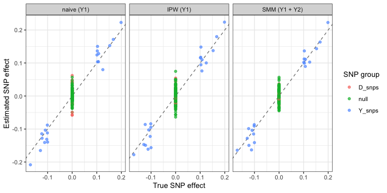

Module (b): Case-control ascertainment and secondary phenotypes
================

- [Scenario](#scenario)
- [1. The problem: naive GWAS in the case-control
  sample](#1-the-problem-naive-gwas-in-the-case-control-sample)
- [2. Diagnostics](#2-diagnostics)
- [3. Corrections](#3-corrections)
  - [Inverse probability weighting](#inverse-probability-weighting)
  - [Scaled marginal model](#scaled-marginal-model)
  - [SPREG](#spreg)
- [4. Summary](#4-summary)

``` r
library(ggplot2)
source("1_functions/gwas_helpers.R")
source("4_correction-individual-level/ipw.R")
source("4_correction-individual-level/spreg_prepare.R")

cols <- c("analysis", "snp_group", "rel_bias_causal", "mean_abs_bias",
          "coverage", "type1_error")
```

## Scenario

Figure 2(b). Genotype G affects a secondary phenotype Y and disease D,
and Y also affects D. Cases are over-sampled: the study has equal
numbers of cases and controls, although only 5% of the population has
the disease. Analysing Y in this sample conditions on D, which distorts
the SNP-Y associations:

- SNPs affecting only disease (`D_snps`) become associated with Y;
- SNPs affecting Y (`Y_snps`) are biased.

Two secondary phenotypes (Y1, Y2) have the same SNP effects on the
standardised scale. Only Y1 affects disease.

``` r
if (!file.exists("data/module_b.rds")) source("2_simulations/b_case_control.R")
d <- readRDS("data/module_b.rds")
p <- d$pheno

knitr::kable(data.frame(parameter = names(d$params),
                        value = format(unlist(d$params), scientific = FALSE,
                                       drop0trailing = TRUE)),
             row.names = FALSE)
```

| parameter  | value  |
|:-----------|:-------|
| n_pop      | 200000 |
| m          | 200    |
| n_causal_y | 20     |
| n_causal_d | 20     |
| h2_y       | 0.1    |
| h2_d       | 0.2    |
| g_yd       | 0.5    |
| r_y        | 0.5    |
| K          | 0.05   |
| n_cases    | 5000   |
| n_controls | 5000   |

## 1. The problem: naive GWAS in the case-control sample

``` r
naive <- run_gwas(p$Y1, d$G)

knitr::kable(compare_by_group(naive, d$truth, d$groups, "naive (Y1)")[, cols],
             digits = 3, row.names = FALSE)
```

| analysis   | snp_group | rel_bias_causal | mean_abs_bias | coverage | type1_error |
|:-----------|:----------|----------------:|--------------:|---------:|------------:|
| naive (Y1) | Y_snps    |           0.115 |         0.021 |    0.800 |         NaN |
| naive (Y1) | D_snps    |             NaN |         0.032 |    0.550 |       0.450 |
| naive (Y1) | null      |             NaN |         0.013 |    0.938 |       0.062 |

Disease-only SNPs show spurious associations with Y1 well above the
nominal 5%, and the Y-acting SNPs are biased.

## 2. Diagnostics

There is no diagnostic specific to this design: the sampling scheme is
known, so bias should be assumed whenever a secondary phenotype is
analysed in a case-control sample. Variants known to affect only the
disease can serve as negative control variants (see module c).

## 3. Corrections

All three corrections use the known population prevalence of the disease
(K = 0.05).

### Inverse probability weighting

Each case and control is weighted by its population share divided by its
sample share.

``` r
w    <- case_control_weights(p$D, d$K)
ipw1 <- ipw_gwas(p$Y1, d$G, w)

knitr::kable(data.frame(group = c("cases", "controls"),
                        weight = round(c(w[p$D == 1][1], w[p$D == 0][1]), 3)),
             row.names = FALSE)
```

| group    | weight |
|:---------|-------:|
| cases    |    0.1 |
| controls |    1.9 |

### Scaled marginal model

When several secondary phenotypes share SNP effects, the scaled marginal
model estimates one common effect across them by weighted GEE, gaining
precision over analysing Y1 alone.

``` r
smm <- smm_gwas(p[, c("Y1", "Y2")], d$G, w)
```

``` r
knitr::kable(rbind(
  compare_by_group(naive, d$truth, d$groups, "naive (Y1)"),
  compare_by_group(ipw1,  d$truth, d$groups, "IPW (Y1)"),
  compare_by_group(smm,   d$truth, d$groups, "SMM (Y1 + Y2)")
)[, cols], digits = 3, row.names = FALSE)
```

| analysis      | snp_group | rel_bias_causal | mean_abs_bias | coverage | type1_error |
|:--------------|:----------|----------------:|--------------:|---------:|------------:|
| naive (Y1)    | Y_snps    |           0.115 |         0.021 |    0.800 |         NaN |
| naive (Y1)    | D_snps    |             NaN |         0.032 |    0.550 |       0.450 |
| naive (Y1)    | null      |             NaN |         0.013 |    0.938 |       0.062 |
| IPW (Y1)      | Y_snps    |           0.064 |         0.022 |    0.850 |         NaN |
| IPW (Y1)      | D_snps    |             NaN |         0.020 |    0.900 |       0.100 |
| IPW (Y1)      | null      |             NaN |         0.017 |    0.963 |       0.038 |
| SMM (Y1 + Y2) | Y_snps    |           0.040 |         0.016 |    0.850 |         NaN |
| SMM (Y1 + Y2) | D_snps    |             NaN |         0.015 |    0.950 |       0.050 |
| SMM (Y1 + Y2) | null      |             NaN |         0.016 |    0.956 |       0.044 |

### SPREG

SPREG (Lin and Zeng 2009) is external software for 64-bit Linux. Run
`4_correction-individual-level/spreg_prepare.R` to write the input file,
then run SPREG as described in the README. Its results are shown here if
the output file exists.

``` r
res_file <- "data/spreg/spreg_output.out"
if (file.exists(res_file)) {
  spreg <- read_spreg(res_file, snp = colnames(d$G), n = nrow(p))
  knitr::kable(compare_by_group(spreg, d$truth, d$groups, "SPREG (Y1)")[, cols],
               digits = 3, row.names = FALSE)
} else {
  cat("SPREG output not found; see the README to run SPREG.\n")
}
```

    ## SPREG output not found; see the README to run SPREG.

## 4. Summary

``` r
grp <- rep(names(d$groups), lengths(d$groups))[order(unlist(d$groups))]

est <- function(res, label) {
  data.frame(analysis = label, snp_group = grp, truth = d$truth,
             beta = res$beta)
}

plot_df <- rbind(est(naive, "naive (Y1)"), est(ipw1, "IPW (Y1)"),
                 est(smm, "SMM (Y1 + Y2)"))
plot_df$analysis <- factor(plot_df$analysis, levels = unique(plot_df$analysis))

ggplot(plot_df, aes(truth, beta, colour = snp_group)) +
  geom_abline(slope = 1, intercept = 0, linetype = "dashed", colour = "grey50") +
  geom_point(alpha = 0.7) +
  facet_wrap(~ analysis, nrow = 1) +
  labs(x = "True SNP effect", y = "Estimated SNP effect",
       colour = "SNP group") +
  theme_bw()
```

<!-- -->

Points on the dashed line are unbiased. In the naive analysis,
disease-only SNPs (true effect 0) spread away from zero. Weighting by
the known sampling fractions brings them back, and the scaled marginal
model does so with the smallest errors by pooling the two secondary
phenotypes.

``` r
sessionInfo()
```

    ## R version 4.6.0 (2026-04-24)
    ## Platform: aarch64-apple-darwin23
    ## Running under: macOS Tahoe 26.7.1
    ## 
    ## Matrix products: default
    ## BLAS:   /System/Library/Frameworks/Accelerate.framework/Versions/A/Frameworks/vecLib.framework/Versions/A/libBLAS.dylib 
    ## LAPACK: /Library/Frameworks/R.framework/Versions/4.6/Resources/lib/libRlapack.dylib;  LAPACK version 3.12.1
    ## 
    ## locale:
    ## [1] en_US.UTF-8/en_US.UTF-8/en_US.UTF-8/C/en_US.UTF-8/en_US.UTF-8
    ## 
    ## time zone: Europe/Copenhagen
    ## tzcode source: internal
    ## 
    ## attached base packages:
    ## [1] stats     graphics  grDevices utils     datasets  methods   base     
    ## 
    ## other attached packages:
    ## [1] ggplot2_4.0.3
    ## 
    ## loaded via a namespace (and not attached):
    ##  [1] gtable_0.3.6       dplyr_1.2.1        compiler_4.6.0     tidyselect_1.2.1   tidyr_1.3.2        scales_1.4.0       yaml_2.3.12        fastmap_1.2.0     
    ##  [9] R6_2.6.1           labeling_0.4.3     generics_0.1.4     knitr_1.51         MASS_7.3-65        backports_1.5.1    tibble_3.3.1       pillar_1.11.1     
    ## [17] RColorBrewer_1.1-3 rlang_1.3.0        broom_1.0.12       xfun_0.59          S7_0.2.2           otel_0.2.0         cli_3.6.6          withr_3.0.3       
    ## [25] magrittr_2.0.5     digest_0.6.39      grid_4.6.0         rstudioapi_0.18.0  geepack_1.3.13     lifecycle_1.0.5    vctrs_0.7.3        evaluate_1.0.5    
    ## [33] glue_1.8.1         farver_2.1.2       codetools_0.2-20   rmarkdown_2.31     purrr_1.2.2        tools_4.6.0        pkgconfig_2.0.3    htmltools_0.5.9
