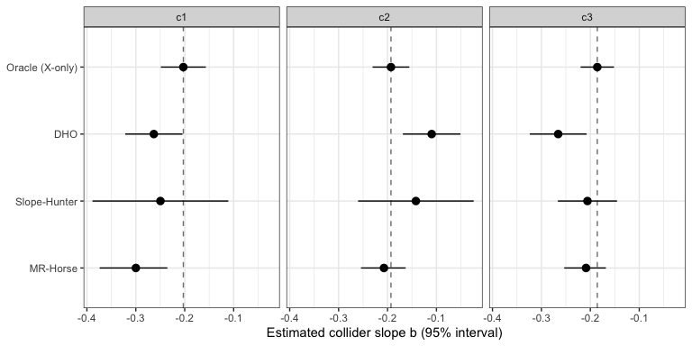
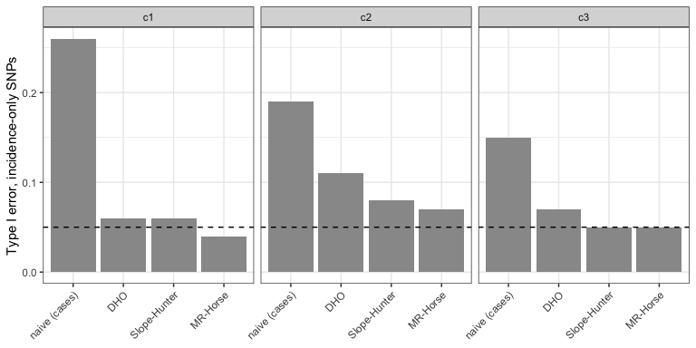

Module (c): Index event bias
================

- [Scenario](#scenario)
- [1. The problem: GWAS of progression among
  cases](#1-the-problem-gwas-of-progression-among-cases)
- [2. Diagnostic: negative control
  variants](#2-diagnostic-negative-control-variants)
- [3. Corrections](#3-corrections)
  - [Estimated collider slopes](#estimated-collider-slopes)
  - [Adjusted SNP effects](#adjusted-snp-effects)
- [4. Summary](#4-summary)

``` r
library(ggplot2)
source("1_functions/gwas_helpers.R")
source("3_diagnostics/negative_controls.R")
source("5_correction-summary-level/dho.R")
source("5_correction-summary-level/slope_hunter.R")
source("5_correction-summary-level/mr_horse.R")

cols <- c("analysis", "snp_group", "mean_abs_bias", "rmse", "coverage",
          "type1_error")
scen <- c("c1", "c2", "c3")
```

## Scenario

Figure 2(c). Genotype G affects disease incidence X and progression Y,
and an unmeasured factor U affects both. Progression is studied only
among cases (X = 1). Conditioning on X induces an association between
incidence SNPs and U, and hence with Y: each SNP’s effect on progression
is biased by about −b·β<sub>X</sub>, where β<sub>X</sub> is its effect
on incidence.

SNPs affect incidence only (`X_only`), progression only (`Y_only`), both
(`both`), or neither (`null`). The three scenarios differ in the SNPs
affecting both:

- **c1 independent:** effects on incidence and progression are
  uncorrelated;
- **c2 correlated:** they are correlated (ρ = 0.6), and incidence-only
  SNPs dominate incidence heritability;
- **c3 sparse:** few SNPs affect progression.

Correction methods for this design use summary statistics: an incidence
GWAS in the full cohort and a progression GWAS among cases.

``` r
if (!all(file.exists(sprintf("data/module_%s.rds", scen))))
  source("2_simulations/c_index_event.R")
dat <- setNames(lapply(scen, function(sc)
  readRDS(sprintf("data/module_%s.rds", sc))), scen)

knitr::kable(do.call(rbind, lapply(scen, function(sc) {
  pr <- dat[[sc]]$params
  data.frame(scenario = sc, label = pr$label, X_only = pr$n_x_only,
             Y_only = pr$n_y_only, both = pr$n_both, rho_both = pr$rho_both,
             cases = dat[[sc]]$n_cases, cohort = pr$n)
})), row.names = FALSE)
```

| scenario | label       | X_only | Y_only | both | rho_both | cases | cohort |
|:---------|:------------|-------:|-------:|-----:|---------:|------:|-------:|
| c1       | independent |     50 |     50 |   50 |      0.0 | 15000 |  50000 |
| c2       | correlated  |    100 |     50 |   25 |      0.6 | 15000 |  50000 |
| c3       | sparse      |    100 |     10 |   10 |      0.0 | 15000 |  50000 |

## 1. The problem: GWAS of progression among cases

``` r
by_scen <- function(res, sc, label) {
  cbind(scenario = sc,
        compare_by_group(res, dat[[sc]]$truth_y, dat[[sc]]$groups, label)[, cols])
}

knitr::kable(do.call(rbind, lapply(scen, function(sc) rbind(
  by_scen(dat[[sc]]$gwas_y_pop, sc, "full cohort (reference)"),
  by_scen(dat[[sc]]$gwas_y,     sc, "cases only (naive)")
))), digits = 3, row.names = FALSE)
```

| scenario | analysis | snp_group | mean_abs_bias | rmse | coverage | type1_error |
|:---|:---|:---|---:|---:|---:|---:|
| c1 | full cohort (reference) | X_only | 0.007 | 0.009 | 0.980 | 0.020 |
| c1 | full cohort (reference) | Y_only | 0.009 | 0.011 | 0.920 | NaN |
| c1 | full cohort (reference) | both | 0.008 | 0.011 | 0.980 | NaN |
| c1 | full cohort (reference) | null | 0.009 | 0.011 | 0.959 | 0.041 |
| c1 | cases only (naive) | X_only | 0.026 | 0.032 | 0.740 | 0.260 |
| c1 | cases only (naive) | Y_only | 0.012 | 0.016 | 0.980 | NaN |
| c1 | cases only (naive) | both | 0.026 | 0.035 | 0.740 | NaN |
| c1 | cases only (naive) | null | 0.015 | 0.019 | 0.958 | 0.042 |
| c2 | full cohort (reference) | X_only | 0.009 | 0.011 | 0.950 | 0.050 |
| c2 | full cohort (reference) | Y_only | 0.009 | 0.011 | 0.980 | NaN |
| c2 | full cohort (reference) | both | 0.006 | 0.008 | 1.000 | NaN |
| c2 | full cohort (reference) | null | 0.009 | 0.011 | 0.921 | 0.079 |
| c2 | cases only (naive) | X_only | 0.022 | 0.029 | 0.810 | 0.190 |
| c2 | cases only (naive) | Y_only | 0.014 | 0.018 | 0.980 | NaN |
| c2 | cases only (naive) | both | 0.019 | 0.024 | 0.920 | NaN |
| c2 | cases only (naive) | null | 0.015 | 0.019 | 0.948 | 0.052 |
| c3 | full cohort (reference) | X_only | 0.007 | 0.010 | 0.950 | 0.050 |
| c3 | full cohort (reference) | Y_only | 0.006 | 0.009 | 0.900 | NaN |
| c3 | full cohort (reference) | both | 0.006 | 0.010 | 0.900 | NaN |
| c3 | full cohort (reference) | null | 0.009 | 0.011 | 0.948 | 0.052 |
| c3 | cases only (naive) | X_only | 0.022 | 0.027 | 0.850 | 0.150 |
| c3 | cases only (naive) | Y_only | 0.014 | 0.017 | 1.000 | NaN |
| c3 | cases only (naive) | both | 0.044 | 0.056 | 0.400 | NaN |
| c3 | cases only (naive) | null | 0.016 | 0.020 | 0.945 | 0.055 |

Among cases, incidence-only SNPs acquire spurious associations with
progression, and SNPs affecting both are biased. Progression-only and
null SNPs are unaffected.

## 2. Diagnostic: negative control variants

Suppose 20 incidence-only SNPs are known from prior evidence not to
affect progression. Collider bias predicts their progression effects to
be opposite in sign to their incidence effects (when U raises both
incidence and progression). A directional test across the variants is
more powerful than counting p \< 0.05, and λ is unstable with so few
variants.

``` r
dir_test <- function(bx, z) {
  zd <- sum(sign(bx) * z) / sqrt(length(z))
  c(directional_z = zd, directional_p = 2 * pnorm(-abs(zd)))
}

knitr::kable(do.call(rbind, lapply(scen, function(sc) {
  d  <- dat[[sc]]
  nc <- d$neg_control
  s  <- d$sumstats[nc, ]
  rbind(
    data.frame(scenario = sc, analysis = "cases (naive)",
               summarise_negative_control(d$gwas_y, nc),
               t(dir_test(s$beta_x, s$beta_y / s$se_y))),
    data.frame(scenario = sc, analysis = "full cohort (reference)",
               summarise_negative_control(d$gwas_y_pop, nc),
               t(dir_test(s$beta_x, s$beta_y_pop / s$se_y_pop))))
})), digits = 3, row.names = FALSE)
```

| scenario | analysis | n_snps | lambda | prop_p_lt_alpha | n_gw_sig | directional_z | directional_p |
|:---|:---|---:|---:|---:|---:|---:|---:|
| c1 | cases (naive) | 20 | 2.171 | 0.25 | 0 | -2.550 | 0.011 |
| c1 | full cohort (reference) | 20 | 0.278 | 0.00 | 0 | 1.766 | 0.077 |
| c2 | cases (naive) | 20 | 2.814 | 0.20 | 0 | -3.345 | 0.001 |
| c2 | full cohort (reference) | 20 | 1.955 | 0.05 | 0 | 0.863 | 0.388 |
| c3 | cases (naive) | 20 | 1.044 | 0.15 | 0 | -2.785 | 0.005 |
| c3 | full cohort (reference) | 20 | 0.763 | 0.00 | 0 | 0.185 | 0.853 |

## 3. Corrections

All three methods estimate the collider slope b and adjust every SNP:
β<sub>Y</sub> − b·β<sub>X</sub>. They differ in how b is estimated:

- **DHO:** regression of β<sub>Y</sub> on β<sub>X</sub> across all SNPs,
  with a Hedges-Olkin correction for regression dilution (`indexevent`
  package). Assumes the SNP effects on incidence and progression are
  uncorrelated.
- **Slope-Hunter:** a mixture model that identifies the cluster of
  incidence-only SNPs and uses its slope (`SlopeHunter` package).
  Assumes incidence-only SNPs contribute at least as much to incidence
  heritability as pleiotropic SNPs.
- **MR-Horse adaptation:** a Bayesian model with a horseshoe prior on
  direct effects on progression, allowing them to be sparse and
  correlated with incidence effects (JAGS).

The oracle is the Hedges-Olkin slope fitted only on the true
incidence-only SNPs. It is a benchmark, not an exact truth, since it
uses estimated effects from 50 to 100 SNPs.

``` r
fits <- setNames(lapply(scen, function(sc) {
  d <- dat[[sc]]
  s <- d$sumstats
  mhs <- mr_horse_slope(s$beta_x, s$se_x, s$beta_y, s$se_y,
                        use = s$p_x < 1e-3,
                        model_file = "5_correction-summary-level/mr_horse_model.jags")
  list(
    dho    = dho_correct(s$snp, s$beta_x, s$se_x, s$beta_y, s$se_y,
                         n = d$n_cases),
    sh     = slope_hunter_correct(s$snp, s$beta_x, s$se_x, s$beta_y, s$se_y,
                                  n = d$n_cases),
    mhs    = mhs,
    mh     = mr_horse_correct(s$snp, s$beta_x, s$se_x, s$beta_y, s$se_y,
                              mhs, n = d$n_cases),
    oracle = indexevent::indexevent(s$beta_x, s$se_x, s$beta_y, s$se_y,
                                    prune = which(s$group == "X_only"),
                                    method = "Hedges-Olkin")
  )
}), scen)
```

### Estimated collider slopes

``` r
slopes <- do.call(rbind, lapply(scen, function(sc) {
  f  <- fits[[sc]]
  fd <- attr(f$dho, "fit")
  fs <- attr(f$sh, "fit")
  data.frame(
    scenario = sc,
    method   = c("Oracle (X-only)", "DHO", "Slope-Hunter", "MR-Horse"),
    slope    = c(f$oracle$b, fd$b, fs$b, f$mhs$b),
    lower    = c(f$oracle$b.ci[1], fd$b.ci[1], fs$b_CI[1], f$mhs$ci[1]),
    upper    = c(f$oracle$b.ci[2], fd$b.ci[2], fs$b_CI[2], f$mhs$ci[2])
  )
}))
knitr::kable(slopes, digits = 3, row.names = FALSE)
```

| scenario | method          |  slope |  lower |  upper |
|:---------|:----------------|-------:|-------:|-------:|
| c1       | Oracle (X-only) | -0.203 | -0.249 | -0.157 |
| c1       | DHO             | -0.263 | -0.322 | -0.205 |
| c1       | Slope-Hunter    | -0.250 | -0.389 | -0.111 |
| c1       | MR-Horse        | -0.300 | -0.374 | -0.235 |
| c2       | Oracle (X-only) | -0.193 | -0.230 | -0.155 |
| c2       | DHO             | -0.110 | -0.169 | -0.051 |
| c2       | Slope-Hunter    | -0.142 | -0.260 | -0.024 |
| c2       | MR-Horse        | -0.207 | -0.254 | -0.163 |
| c3       | Oracle (X-only) | -0.186 | -0.220 | -0.152 |
| c3       | DHO             | -0.266 | -0.324 | -0.208 |
| c3       | Slope-Hunter    | -0.206 | -0.266 | -0.145 |
| c3       | MR-Horse        | -0.209 | -0.253 | -0.168 |

``` r
# Agreement of Slope-Hunter's incidence-only cluster with the truth
knitr::kable(do.call(rbind, lapply(scen, function(sc) {
  fs     <- attr(fits[[sc]]$sh, "fit")
  hunted <- as.character(fs$Fit$SNP[fs$Fit$clusters == "Hunted"])
  truth  <- dat[[sc]]$sumstats$group[match(hunted, dat[[sc]]$sumstats$snp)]
  data.frame(scenario = sc, snps_hunted = length(hunted),
             pct_truly_X_only = round(100 * mean(truth == "X_only")))
})), row.names = FALSE)
```

| scenario | snps_hunted | pct_truly_X_only |
|:---------|------------:|-----------------:|
| c1       |          33 |               79 |
| c2       |          15 |               93 |
| c3       |          50 |               96 |

### Adjusted SNP effects

``` r
adj <- do.call(rbind, lapply(scen, function(sc) rbind(
  by_scen(dat[[sc]]$gwas_y, sc, "naive (cases)"),
  by_scen(fits[[sc]]$dho,   sc, "DHO"),
  by_scen(fits[[sc]]$sh,    sc, "Slope-Hunter"),
  by_scen(fits[[sc]]$mh,    sc, "MR-Horse")
)))
knitr::kable(adj, digits = 3, row.names = FALSE)
```

| scenario | analysis      | snp_group | mean_abs_bias |  rmse | coverage | type1_error |
|:---------|:--------------|:----------|--------------:|------:|---------:|------------:|
| c1       | naive (cases) | X_only    |         0.026 | 0.032 |    0.740 |       0.260 |
| c1       | naive (cases) | Y_only    |         0.012 | 0.016 |    0.980 |         NaN |
| c1       | naive (cases) | both      |         0.026 | 0.035 |    0.740 |         NaN |
| c1       | naive (cases) | null      |         0.015 | 0.019 |    0.958 |       0.042 |
| c1       | DHO           | X_only    |         0.016 | 0.020 |    0.940 |       0.060 |
| c1       | DHO           | Y_only    |         0.012 | 0.016 |    0.960 |         NaN |
| c1       | DHO           | both      |         0.015 | 0.019 |    0.980 |         NaN |
| c1       | DHO           | null      |         0.015 | 0.020 |    0.952 |       0.048 |
| c1       | Slope-Hunter  | X_only    |         0.016 | 0.019 |    0.940 |       0.060 |
| c1       | Slope-Hunter  | Y_only    |         0.012 | 0.016 |    0.960 |         NaN |
| c1       | Slope-Hunter  | both      |         0.015 | 0.019 |    0.980 |         NaN |
| c1       | Slope-Hunter  | null      |         0.015 | 0.020 |    0.953 |       0.047 |
| c1       | MR-Horse      | X_only    |         0.018 | 0.022 |    0.960 |       0.040 |
| c1       | MR-Horse      | Y_only    |         0.012 | 0.017 |    0.960 |         NaN |
| c1       | MR-Horse      | both      |         0.016 | 0.020 |    0.980 |         NaN |
| c1       | MR-Horse      | null      |         0.016 | 0.020 |    0.952 |       0.048 |
| c2       | naive (cases) | X_only    |         0.022 | 0.029 |    0.810 |       0.190 |
| c2       | naive (cases) | Y_only    |         0.014 | 0.018 |    0.980 |         NaN |
| c2       | naive (cases) | both      |         0.019 | 0.024 |    0.920 |         NaN |
| c2       | naive (cases) | null      |         0.015 | 0.019 |    0.948 |       0.052 |
| c2       | DHO           | X_only    |         0.017 | 0.022 |    0.890 |       0.110 |
| c2       | DHO           | Y_only    |         0.014 | 0.018 |    0.980 |         NaN |
| c2       | DHO           | both      |         0.015 | 0.018 |    0.920 |         NaN |
| c2       | DHO           | null      |         0.015 | 0.019 |    0.943 |       0.057 |
| c2       | Slope-Hunter  | X_only    |         0.016 | 0.020 |    0.920 |       0.080 |
| c2       | Slope-Hunter  | Y_only    |         0.014 | 0.018 |    0.980 |         NaN |
| c2       | Slope-Hunter  | both      |         0.014 | 0.017 |    0.960 |         NaN |
| c2       | Slope-Hunter  | null      |         0.015 | 0.019 |    0.943 |       0.057 |
| c2       | MR-Horse      | X_only    |         0.016 | 0.020 |    0.930 |       0.070 |
| c2       | MR-Horse      | Y_only    |         0.014 | 0.018 |    0.980 |         NaN |
| c2       | MR-Horse      | both      |         0.013 | 0.016 |    0.960 |         NaN |
| c2       | MR-Horse      | null      |         0.015 | 0.020 |    0.941 |       0.059 |
| c3       | naive (cases) | X_only    |         0.022 | 0.027 |    0.850 |       0.150 |
| c3       | naive (cases) | Y_only    |         0.014 | 0.017 |    1.000 |         NaN |
| c3       | naive (cases) | both      |         0.044 | 0.056 |    0.400 |         NaN |
| c3       | naive (cases) | null      |         0.016 | 0.020 |    0.945 |       0.055 |
| c3       | DHO           | X_only    |         0.016 | 0.020 |    0.930 |       0.070 |
| c3       | DHO           | Y_only    |         0.014 | 0.017 |    1.000 |         NaN |
| c3       | DHO           | both      |         0.017 | 0.020 |    0.900 |         NaN |
| c3       | DHO           | null      |         0.016 | 0.021 |    0.948 |       0.052 |
| c3       | Slope-Hunter  | X_only    |         0.014 | 0.018 |    0.950 |       0.050 |
| c3       | Slope-Hunter  | Y_only    |         0.014 | 0.017 |    1.000 |         NaN |
| c3       | Slope-Hunter  | both      |         0.015 | 0.018 |    0.900 |         NaN |
| c3       | Slope-Hunter  | null      |         0.016 | 0.020 |    0.950 |       0.050 |
| c3       | MR-Horse      | X_only    |         0.014 | 0.018 |    0.950 |       0.050 |
| c3       | MR-Horse      | Y_only    |         0.014 | 0.017 |    1.000 |         NaN |
| c3       | MR-Horse      | both      |         0.014 | 0.018 |    0.900 |         NaN |
| c3       | MR-Horse      | null      |         0.016 | 0.020 |    0.950 |       0.050 |

## 4. Summary

``` r
slopes$method <- factor(slopes$method,
                        levels = rev(c("Oracle (X-only)", "DHO",
                                       "Slope-Hunter", "MR-Horse")))

ggplot(slopes, aes(slope, method)) +
  geom_vline(data = subset(slopes, method == "Oracle (X-only)"),
             aes(xintercept = slope), linetype = "dashed", colour = "grey50") +
  geom_pointrange(aes(xmin = lower, xmax = upper)) +
  facet_wrap(~ scenario, nrow = 1) +
  labs(x = "Estimated collider slope b (95% interval)", y = NULL) +
  theme_bw()
```

<!-- -->

``` r
t1 <- subset(adj, snp_group == "X_only")
t1$analysis <- factor(t1$analysis, levels = c("naive (cases)", "DHO",
                                              "Slope-Hunter", "MR-Horse"))

ggplot(t1, aes(analysis, type1_error)) +
  geom_col(fill = "grey60") +
  geom_hline(yintercept = 0.05, linetype = "dashed") +
  facet_wrap(~ scenario, nrow = 1) +
  labs(x = NULL, y = "Type I error, incidence-only SNPs") +
  theme_bw() +
  theme(axis.text.x = element_text(angle = 45, hjust = 1))
```

<!-- -->

All three methods reduce the spurious associations of incidence-only
SNPs towards the nominal 5%, but none is best in every scenario. DHO
performs well when effects on incidence and progression are independent
but under-corrects under correlated pleiotropy (c2). Slope-Hunter
depends on incidence-only SNPs dominating incidence heritability. The
MR-Horse adaptation is closest to the oracle under correlated
pleiotropy, but its prior can over-correct when that correlation is
absent (c1).

``` r
sessionInfo()
```

    ## R version 4.6.0 (2026-04-24)
    ## Platform: aarch64-apple-darwin23
    ## Running under: macOS Tahoe 26.7.1
    ## 
    ## Matrix products: default
    ## BLAS:   /System/Library/Frameworks/Accelerate.framework/Versions/A/Frameworks/vecLib.framework/Versions/A/libBLAS.dylib 
    ## LAPACK: /Library/Frameworks/R.framework/Versions/4.6/Resources/lib/libRlapack.dylib;  LAPACK version 3.12.1
    ## 
    ## locale:
    ## [1] en_US.UTF-8/en_US.UTF-8/en_US.UTF-8/C/en_US.UTF-8/en_US.UTF-8
    ## 
    ## time zone: Europe/Copenhagen
    ## tzcode source: internal
    ## 
    ## attached base packages:
    ## [1] stats     graphics  grDevices utils     datasets  methods   base     
    ## 
    ## other attached packages:
    ## [1] ggplot2_4.0.3
    ## 
    ## loaded via a namespace (and not attached):
    ##  [1] gtable_0.3.6           xfun_0.59              htmlwidgets_1.6.4      lattice_0.22-9         vctrs_0.7.3           
    ##  [6] tools_4.6.0            generics_0.1.4         stats4_4.6.0           sandwich_3.1-2         tibble_3.3.1          
    ## [11] pkgconfig_2.0.3        indexevent_0.2.0       Matrix_1.7-5           data.table_1.18.2.1    RColorBrewer_1.1-3    
    ## [16] S7_0.2.2               lifecycle_1.0.5        compiler_4.6.0         farver_2.1.2           maxLik_1.6-10         
    ## [21] codetools_0.2-20       systemfit_1.1-30       carData_3.0-6          htmltools_0.5.9        yaml_2.3.12           
    ## [26] lazyeval_0.2.3         Formula_1.2-6          plotly_4.12.0          pillar_1.11.1          car_3.1-5             
    ## [31] tidyr_1.3.2            MASS_7.3-65            abind_1.4-8            mclust_6.1.3           tidyselect_1.2.1      
    ## [36] digest_0.6.39          mvtnorm_1.4-2          dplyr_1.2.1            purrr_1.2.2            labeling_0.4.3        
    ## [41] geepack_1.3.13         splines_4.6.0          miscTools_0.6-30       fastmap_1.2.0          grid_4.6.0            
    ## [46] cli_3.6.6              magrittr_2.0.5         broom_1.0.12           SlopeHunter_1.1.0      withr_3.0.3           
    ## [51] scales_1.4.0           backports_1.5.1        rmarkdown_2.31         httr_1.4.8             otel_0.2.0            
    ## [56] sampleSelection_1.2-16 rjags_4-18             zoo_1.8-15             VGAM_1.1-14            coda_0.19-4.1         
    ## [61] evaluate_1.0.5         knitr_1.51             lmtest_0.9-40          viridisLite_0.4.3      rlang_1.3.0           
    ## [66] glue_1.8.1             rstudioapi_0.18.0      jsonlite_2.0.0         ieugwasr_1.1.0.9000    R6_2.6.1
