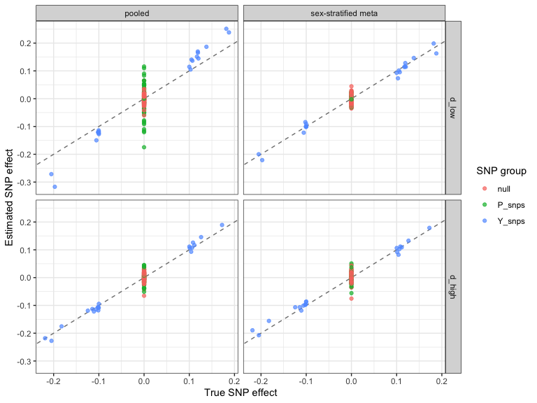

Module (d): Sex-differential participation
================

- [Scenario](#scenario)
- [1. The problem: pooled GWAS of men and
  women](#1-the-problem-pooled-gwas-of-men-and-women)
- [2. Diagnostic: participation GWAS](#2-diagnostic-participation-gwas)
- [3. Correction: sex-stratified GWAS
  meta-analysis](#3-correction-sex-stratified-gwas-meta-analysis)
- [4. Summary](#4-summary)

``` r
library(ggplot2)
source("1_functions/gwas_helpers.R")
source("3_diagnostics/participation_gwas.R")
source("5_correction-summary-level/sex_stratified.R")

cols <- c("analysis", "snp_group", "mean_abs_bias", "rmse", "coverage",
          "type1_error")
scen <- c("d_low", "d_high")
```

## Scenario

Figure 2(d). Genotype G and sex affect the outcome Y. Participation S
depends on G with different effects in men and women, on sex, and on Y
in opposite directions in men and women (following Lee et al. 2022).
Pooling men and women then induces associations between participation
SNPs and sex, and through sex with Y.

SNPs affect Y (`Y_snps`), participation (`P_snps`), or neither (`null`).
Two scenarios differ only in how common participation is:

- **d_low:** 5% of the population participates;
- **d_high:** 50% participates.

Both have about 15,000 participants.

``` r
if (!all(file.exists(sprintf("data/module_%s.rds", scen))))
  source("2_simulations/d_sex_differential.R")
dat <- setNames(lapply(scen, function(sc)
  readRDS(sprintf("data/module_%s.rds", sc))), scen)

knitr::kable(do.call(rbind, lapply(scen, function(sc) {
  d <- dat[[sc]]
  data.frame(scenario = sc, participation = d$params$rate,
             population = d$n_pop, participants = nrow(d$pheno),
             pct_male = round(100 * mean(d$pheno$Sex)))
})), row.names = FALSE)
```

| scenario | participation | population | participants | pct_male |
|:---------|--------------:|-----------:|-------------:|---------:|
| d_low    |          0.05 |      3e+05 |        15091 |       48 |
| d_high   |          0.50 |      3e+04 |        15060 |       65 |

## 1. The problem: pooled GWAS of men and women

``` r
by_scen <- function(res, sc, label) {
  cbind(scenario = sc,
        compare_by_group(res, dat[[sc]]$truth, dat[[sc]]$groups, label)[, cols])
}

pooled <- setNames(lapply(scen, function(sc)
  run_gwas(dat[[sc]]$pheno$Y, dat[[sc]]$G)), scen)

knitr::kable(do.call(rbind, lapply(scen, function(sc)
  by_scen(pooled[[sc]], sc, "pooled"))), digits = 3, row.names = FALSE)
```

| scenario | analysis | snp_group | mean_abs_bias |  rmse | coverage | type1_error |
|:---------|:---------|:----------|--------------:|------:|---------:|------------:|
| d_low    | pooled   | Y_snps    |         0.038 | 0.046 |    0.500 |         NaN |
| d_low    | pooled   | P_snps    |         0.049 | 0.061 |    0.420 |       0.580 |
| d_low    | pooled   | null      |         0.014 | 0.018 |    0.969 |       0.031 |
| d_high   | pooled   | Y_snps    |         0.009 | 0.011 |    1.000 |         NaN |
| d_high   | pooled   | P_snps    |         0.016 | 0.022 |    0.800 |       0.200 |
| d_high   | pooled   | null      |         0.012 | 0.015 |    0.954 |       0.046 |

Participation SNPs, which have no effect on Y, become associated with
it, and Y-acting SNPs are biased when participation is rare.

## 2. Diagnostic: participation GWAS

There is no participation indicator for non-participants here. Instead,
sex-differential participation is detected by testing SNP-sex
associations among participants. Autosomal SNPs cannot cause biological
sex, so any association indicates selection.

``` r
for (sc in scen) {
  d  <- dat[[sc]]
  sg <- sex_gwas(d$pheno$Sex, d$G)
  s  <- summarise_participation(sg)
  cat(sprintf("\n%s: lambda = %.2f\n", sc, attr(s, "lambda")))
  print(s, row.names = FALSE)
  cat("Proportion of SNPs with p < 0.05, by group:\n")
  print(round(sapply(d$groups, function(i) mean(sg$p[i] < 0.05)), 2))
}
```

    ## 
    ## d_low: lambda = 3.00
    ##  threshold observed expected    ratio
    ##      5e-02       63    1e+01 6.30e+00
    ##      1e-03       45    2e-01 2.25e+02
    ##      5e-08       22    1e-05 2.20e+06
    ## Proportion of SNPs with p < 0.05, by group:
    ## Y_snps P_snps   null 
    ##   0.95   0.74   0.05 
    ## 
    ## d_high: lambda = 2.44
    ##  threshold observed expected    ratio
    ##      5e-02       42    1e+01      4.2
    ##      1e-03       23    2e-01    115.0
    ##      5e-08        6    1e-05 600000.0
    ## Proportion of SNPs with p < 0.05, by group:
    ## Y_snps P_snps   null 
    ##   0.45   0.56   0.04

Both participation SNPs and Y-acting SNPs are associated with sex,
because participation depends on the genotype and on the outcome
differently in men and women. The diagnostic detects either route.

## 3. Correction: sex-stratified GWAS meta-analysis

GWAS are run separately in men and women and combined by
inverse-variance weighted fixed-effects meta-analysis (Lee et al. 2022).
A pooled GWAS adjusted for sex is shown for comparison.

``` r
fits <- setNames(lapply(scen, function(sc) {
  p <- dat[[sc]]$pheno
  list(adj   = run_gwas(p$Y, dat[[sc]]$G, covar = p[, "Sex", drop = FALSE]),
       strat = sex_stratified_gwas(p$Y, dat[[sc]]$G, p$Sex))
}), scen)

res <- do.call(rbind, lapply(scen, function(sc) rbind(
  by_scen(pooled[[sc]],      sc, "pooled"),
  by_scen(fits[[sc]]$adj,    sc, "pooled, sex-adjusted"),
  by_scen(fits[[sc]]$strat,  sc, "sex-stratified meta")
)))
knitr::kable(res, digits = 3, row.names = FALSE)
```

| scenario | analysis | snp_group | mean_abs_bias | rmse | coverage | type1_error |
|:---|:---|:---|---:|---:|---:|---:|
| d_low | pooled | Y_snps | 0.038 | 0.046 | 0.500 | NaN |
| d_low | pooled | P_snps | 0.049 | 0.061 | 0.420 | 0.580 |
| d_low | pooled | null | 0.014 | 0.018 | 0.969 | 0.031 |
| d_low | pooled, sex-adjusted | Y_snps | 0.010 | 0.013 | 0.950 | NaN |
| d_low | pooled, sex-adjusted | P_snps | 0.010 | 0.013 | 0.960 | 0.040 |
| d_low | pooled, sex-adjusted | null | 0.012 | 0.014 | 0.985 | 0.015 |
| d_low | sex-stratified meta | Y_snps | 0.010 | 0.013 | 0.950 | NaN |
| d_low | sex-stratified meta | P_snps | 0.010 | 0.013 | 0.960 | 0.040 |
| d_low | sex-stratified meta | null | 0.012 | 0.014 | 0.977 | 0.023 |
| d_high | pooled | Y_snps | 0.009 | 0.011 | 1.000 | NaN |
| d_high | pooled | P_snps | 0.016 | 0.022 | 0.800 | 0.200 |
| d_high | pooled | null | 0.012 | 0.015 | 0.954 | 0.046 |
| d_high | pooled, sex-adjusted | Y_snps | 0.010 | 0.013 | 1.000 | NaN |
| d_high | pooled, sex-adjusted | P_snps | 0.015 | 0.019 | 0.860 | 0.140 |
| d_high | pooled, sex-adjusted | null | 0.011 | 0.015 | 0.954 | 0.046 |
| d_high | sex-stratified meta | Y_snps | 0.010 | 0.013 | 1.000 | NaN |
| d_high | sex-stratified meta | P_snps | 0.015 | 0.020 | 0.860 | 0.140 |
| d_high | sex-stratified meta | null | 0.011 | 0.015 | 0.954 | 0.046 |

Stratification removes the bias when participation is rare (d_low) but
not when it is common (d_high). There, participation within each sex
still depends on both the participation SNPs and Y, so conditioning on
it induces an association between them. Stratification and sex
adjustment perform equally here; stratification also allows sex-specific
SNP effects, which Cochran’s Q tests.

``` r
knitr::kable(data.frame(
  scenario = scen,
  prop_het_p_lt_0.05 = sapply(scen, function(sc)
    mean(fits[[sc]]$strat$het_p < 0.05, na.rm = TRUE))
), digits = 3, row.names = FALSE)
```

| scenario | prop_het_p_lt_0.05 |
|:---------|-------------------:|
| d_low    |              0.070 |
| d_high   |              0.065 |

## 4. Summary

``` r
plot_df <- do.call(rbind, lapply(scen, function(sc) {
  d   <- dat[[sc]]
  grp <- rep(names(d$groups), lengths(d$groups))[order(unlist(d$groups))]
  rbind(
    data.frame(scenario = sc, analysis = "pooled",              snp_group = grp,
               truth = d$truth, beta = pooled[[sc]]$beta),
    data.frame(scenario = sc, analysis = "sex-stratified meta", snp_group = grp,
               truth = d$truth, beta = fits[[sc]]$strat$beta)
  )
}))
plot_df$scenario <- factor(plot_df$scenario, levels = scen)

ggplot(plot_df, aes(truth, beta, colour = snp_group)) +
  geom_abline(slope = 1, intercept = 0, linetype = "dashed", colour = "grey50") +
  geom_point(alpha = 0.7) +
  facet_grid(scenario ~ analysis) +
  labs(x = "True SNP effect", y = "Estimated SNP effect",
       colour = "SNP group") +
  theme_bw()
```

<!-- -->

Points on the dashed line are unbiased. When participation is rare,
pooling men and women pulls participation SNPs away from zero and
distorts Y-acting SNPs, and stratification restores them. When
participation is common, some participation SNPs remain off the line
after stratification.

``` r
sessionInfo()
```

    ## R version 4.6.0 (2026-04-24)
    ## Platform: aarch64-apple-darwin23
    ## Running under: macOS Tahoe 26.7.1
    ## 
    ## Matrix products: default
    ## BLAS:   /System/Library/Frameworks/Accelerate.framework/Versions/A/Frameworks/vecLib.framework/Versions/A/libBLAS.dylib 
    ## LAPACK: /Library/Frameworks/R.framework/Versions/4.6/Resources/lib/libRlapack.dylib;  LAPACK version 3.12.1
    ## 
    ## locale:
    ## [1] en_US.UTF-8/en_US.UTF-8/en_US.UTF-8/C/en_US.UTF-8/en_US.UTF-8
    ## 
    ## time zone: Europe/Copenhagen
    ## tzcode source: internal
    ## 
    ## attached base packages:
    ## [1] stats     graphics  grDevices utils     datasets  methods   base     
    ## 
    ## other attached packages:
    ## [1] ggplot2_4.0.3
    ## 
    ## loaded via a namespace (and not attached):
    ##  [1] gtable_0.3.6           xfun_0.59              htmlwidgets_1.6.4      lattice_0.22-9         vctrs_0.7.3           
    ##  [6] tools_4.6.0            generics_0.1.4         stats4_4.6.0           sandwich_3.1-2         tibble_3.3.1          
    ## [11] pkgconfig_2.0.3        indexevent_0.2.0       Matrix_1.7-5           data.table_1.18.2.1    RColorBrewer_1.1-3    
    ## [16] S7_0.2.2               lifecycle_1.0.5        compiler_4.6.0         farver_2.1.2           maxLik_1.6-10         
    ## [21] codetools_0.2-20       systemfit_1.1-30       carData_3.0-6          htmltools_0.5.9        yaml_2.3.12           
    ## [26] lazyeval_0.2.3         Formula_1.2-6          plotly_4.12.0          pillar_1.11.1          car_3.1-5             
    ## [31] tidyr_1.3.2            MASS_7.3-65            abind_1.4-8            mclust_6.1.3           tidyselect_1.2.1      
    ## [36] digest_0.6.39          mvtnorm_1.4-2          dplyr_1.2.1            purrr_1.2.2            labeling_0.4.3        
    ## [41] geepack_1.3.13         splines_4.6.0          miscTools_0.6-30       fastmap_1.2.0          grid_4.6.0            
    ## [46] cli_3.6.6              magrittr_2.0.5         broom_1.0.12           SlopeHunter_1.1.0      withr_3.0.3           
    ## [51] scales_1.4.0           backports_1.5.1        rmarkdown_2.31         httr_1.4.8             otel_0.2.0            
    ## [56] sampleSelection_1.2-16 rjags_4-18             zoo_1.8-15             VGAM_1.1-14            coda_0.19-4.1         
    ## [61] evaluate_1.0.5         knitr_1.51             lmtest_0.9-40          viridisLite_0.4.3      rlang_1.3.0           
    ## [66] glue_1.8.1             rstudioapi_0.18.0      jsonlite_2.0.0         ieugwasr_1.1.0.9000    R6_2.6.1
