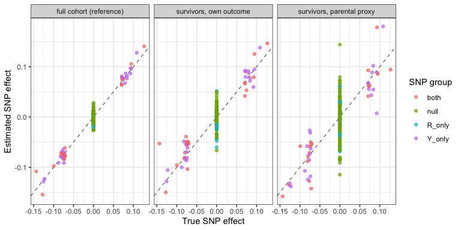

Module (e): Survival to recruitment
================

- [Scenario](#scenario)
- [1. The problem: GWAS among
  survivors](#1-the-problem-gwas-among-survivors)
- [2. Diagnostic: proxy outcomes](#2-diagnostic-proxy-outcomes)
- [3. Correction](#3-correction)
- [4. Summary](#4-summary)

``` r
library(ggplot2)
source("1_functions/gwas_helpers.R")
source("3_diagnostics/proxy_outcomes.R")

cols <- c("analysis", "snp_group", "mean_abs_bias", "rmse", "coverage",
          "power", "type1_error")
```

## Scenario

Figure 2(e). Genotype G affects the outcome Y and survival to
recruitment R, and an unmeasured factor U affects both. Only people
alive at recruitment are studied. Conditioning on survival induces an
association between survival SNPs and U, and hence with Y.

Parents’ outcomes Y<sub>P</sub> depend on the parent’s genotype
G<sub>P</sub>, half of which each participant inherits, and on the
parent’s own U<sub>P</sub>. They are recorded whether or not the parent
survived, so they are not affected by the participant’s survival.

SNPs affect Y only (`Y_only`), survival only (`R_only`), both (`both`),
or neither (`null`).

``` r
if (!file.exists("data/module_e.rds")) source("2_simulations/e_survival.R")
d <- readRDS("data/module_e.rds")
p <- d$pheno
alive <- p$R == 1

knitr::kable(data.frame(parameter = names(d$params),
                        value = format(unlist(d$params), scientific = FALSE,
                                       drop0trailing = TRUE)),
             row.names = FALSE)
```

| parameter | value |
|:----------|:------|
| n         | 50000 |
| m         | 200   |
| n_y_only  | 20    |
| n_r_only  | 20    |
| n_both    | 20    |
| h2_y      | 0.1   |
| h2_r      | 0.3   |
| b_uy      | 0.8   |
| g_u       | 1.5   |
| surv      | 0.3   |

``` r
cat(sprintf("%d of %d alive at recruitment (%.0f%%)\n",
            sum(alive), nrow(p), 100 * mean(alive)))
```

    ## 15051 of 50000 alive at recruitment (30%)

## 1. The problem: GWAS among survivors

``` r
full <- run_gwas(p$Y, d$G)
own  <- run_gwas(p$Y[alive], d$G[alive, ])

knitr::kable(rbind(
  compare_by_group(full, d$truth, d$groups, "full cohort (reference)"),
  compare_by_group(own,  d$truth, d$groups, "survivors (naive)")
)[, cols], digits = 3, row.names = FALSE)
```

| analysis | snp_group | mean_abs_bias | rmse | coverage | power | type1_error |
|:---|:---|---:|---:|---:|---:|---:|
| full cohort (reference) | Y_only | 0.007 | 0.008 | 0.950 | 1.00 | NaN |
| full cohort (reference) | R_only | 0.008 | 0.011 | 0.950 | NaN | 0.050 |
| full cohort (reference) | both | 0.009 | 0.012 | 0.950 | 1.00 | NaN |
| full cohort (reference) | null | 0.008 | 0.010 | 0.950 | NaN | 0.050 |
| survivors (naive) | Y_only | 0.014 | 0.017 | 0.950 | 1.00 | NaN |
| survivors (naive) | R_only | 0.024 | 0.029 | 0.750 | NaN | 0.250 |
| survivors (naive) | both | 0.022 | 0.029 | 0.800 | 0.95 | NaN |
| survivors (naive) | null | 0.014 | 0.019 | 0.936 | NaN | 0.064 |

Among survivors, survival-only SNPs acquire spurious associations with
Y, and SNPs affecting both are biased.

## 2. Diagnostic: proxy outcomes

Participants’ genotypes are regressed on their parents’ outcomes. A
participant carries half of a parent’s alleles, so proxy effects are
multiplied by 2.

``` r
proxy <- proxy_gwas(p$Y_P[alive], d$G[alive, ])

knitr::kable(rbind(
  compare_by_group(own,   d$truth, d$groups, "survivors, own outcome"),
  compare_by_group(proxy, d$truth, d$groups, "survivors, parental proxy")
)[, cols], digits = 3, row.names = FALSE)
```

| analysis | snp_group | mean_abs_bias | rmse | coverage | power | type1_error |
|:---|:---|---:|---:|---:|---:|---:|
| survivors, own outcome | Y_only | 0.014 | 0.017 | 0.950 | 1.00 | NaN |
| survivors, own outcome | R_only | 0.024 | 0.029 | 0.750 | NaN | 0.250 |
| survivors, own outcome | both | 0.022 | 0.029 | 0.800 | 0.95 | NaN |
| survivors, own outcome | null | 0.014 | 0.019 | 0.936 | NaN | 0.064 |
| survivors, parental proxy | Y_only | 0.027 | 0.035 | 0.950 | 0.65 | NaN |
| survivors, parental proxy | R_only | 0.031 | 0.036 | 0.900 | NaN | 0.100 |
| survivors, parental proxy | both | 0.024 | 0.032 | 0.900 | 0.65 | NaN |
| survivors, parental proxy | null | 0.031 | 0.040 | 0.950 | NaN | 0.050 |

The proxy estimates are unbiased in every SNP group, but less precise:
the proxy carries half the genetic signal, so its standard errors are
about twice as large.

A SNP whose own-outcome estimate differs from its proxy estimate
indicates selection on the participant’s outcome.

``` r
cmp <- compare_own_proxy(own, proxy)

knitr::kable(rbind(
  cbind(snp_group = "all", summarise_own_proxy(cmp)),
  do.call(rbind, lapply(names(d$groups), function(g)
    cbind(snp_group = g, summarise_own_proxy(cmp, d$groups[[g]]))))
), digits = 4, row.names = FALSE)
```

| snp_group | n_snps | lambda | prop_p_lt_0.05 | omnibus_p |
|:----------|-------:|-------:|---------------:|----------:|
| all       |    200 | 1.0347 |           0.06 |    0.2130 |
| Y_only    |     20 | 1.2213 |           0.00 |    0.7349 |
| R_only    |     20 | 1.2005 |           0.10 |    0.1162 |
| both      |     20 | 1.4277 |           0.15 |    0.0843 |
| null      |    140 | 0.8881 |           0.05 |    0.4127 |

The difference is concentrated in SNPs that affect survival and diluted
across all SNPs. Because the proxy’s standard errors dominate the
comparison, this diagnostic needs large samples.

## 3. Correction

No correction method is retained for this structure. Where parental
outcomes are available, the proxy estimates can be used in place of the
biased own-outcome estimates, at the cost of precision.

## 4. Summary

``` r
grp <- rep(names(d$groups), lengths(d$groups))[order(unlist(d$groups))]

plot_df <- rbind(
  data.frame(analysis = "full cohort (reference)", snp_group = grp,
             truth = d$truth, beta = full$beta),
  data.frame(analysis = "survivors, own outcome", snp_group = grp,
             truth = d$truth, beta = own$beta),
  data.frame(analysis = "survivors, parental proxy", snp_group = grp,
             truth = d$truth, beta = proxy$beta)
)
plot_df$analysis <- factor(plot_df$analysis, levels = unique(plot_df$analysis))

ggplot(plot_df, aes(truth, beta, colour = snp_group)) +
  geom_abline(slope = 1, intercept = 0, linetype = "dashed", colour = "grey50") +
  geom_point(alpha = 0.7) +
  facet_wrap(~ analysis, nrow = 1) +
  labs(x = "True SNP effect", y = "Estimated SNP effect",
       colour = "SNP group") +
  theme_bw()
```

<!-- -->

Points on the dashed line are unbiased. Among survivors, survival-only
SNPs (true effect 0) move away from zero. Their parental proxy estimates
return to the line, with more scatter.

``` r
sessionInfo()
```

    ## R version 4.6.0 (2026-04-24)
    ## Platform: aarch64-apple-darwin23
    ## Running under: macOS Tahoe 26.7.1
    ## 
    ## Matrix products: default
    ## BLAS:   /System/Library/Frameworks/Accelerate.framework/Versions/A/Frameworks/vecLib.framework/Versions/A/libBLAS.dylib 
    ## LAPACK: /Library/Frameworks/R.framework/Versions/4.6/Resources/lib/libRlapack.dylib;  LAPACK version 3.12.1
    ## 
    ## locale:
    ## [1] en_US.UTF-8/en_US.UTF-8/en_US.UTF-8/C/en_US.UTF-8/en_US.UTF-8
    ## 
    ## time zone: Europe/Copenhagen
    ## tzcode source: internal
    ## 
    ## attached base packages:
    ## [1] stats     graphics  grDevices utils     datasets  methods   base     
    ## 
    ## other attached packages:
    ## [1] ggplot2_4.0.3
    ## 
    ## loaded via a namespace (and not attached):
    ##  [1] gtable_0.3.6           xfun_0.59              htmlwidgets_1.6.4      lattice_0.22-9         vctrs_0.7.3           
    ##  [6] tools_4.6.0            generics_0.1.4         stats4_4.6.0           sandwich_3.1-2         tibble_3.3.1          
    ## [11] pkgconfig_2.0.3        indexevent_0.2.0       Matrix_1.7-5           data.table_1.18.2.1    RColorBrewer_1.1-3    
    ## [16] S7_0.2.2               lifecycle_1.0.5        compiler_4.6.0         farver_2.1.2           maxLik_1.6-10         
    ## [21] codetools_0.2-20       systemfit_1.1-30       carData_3.0-6          htmltools_0.5.9        yaml_2.3.12           
    ## [26] lazyeval_0.2.3         Formula_1.2-6          plotly_4.12.0          pillar_1.11.1          car_3.1-5             
    ## [31] tidyr_1.3.2            MASS_7.3-65            abind_1.4-8            mclust_6.1.3           tidyselect_1.2.1      
    ## [36] digest_0.6.39          mvtnorm_1.4-2          dplyr_1.2.1            purrr_1.2.2            labeling_0.4.3        
    ## [41] geepack_1.3.13         splines_4.6.0          miscTools_0.6-30       fastmap_1.2.0          grid_4.6.0            
    ## [46] cli_3.6.6              magrittr_2.0.5         broom_1.0.12           SlopeHunter_1.1.0      withr_3.0.3           
    ## [51] scales_1.4.0           backports_1.5.1        rmarkdown_2.31         httr_1.4.8             otel_0.2.0            
    ## [56] sampleSelection_1.2-16 rjags_4-18             zoo_1.8-15             VGAM_1.1-14            coda_0.19-4.1         
    ## [61] evaluate_1.0.5         knitr_1.51             lmtest_0.9-40          viridisLite_0.4.3      rlang_1.3.0           
    ## [66] glue_1.8.1             rstudioapi_0.18.0      jsonlite_2.0.0         ieugwasr_1.1.0.9000    R6_2.6.1
